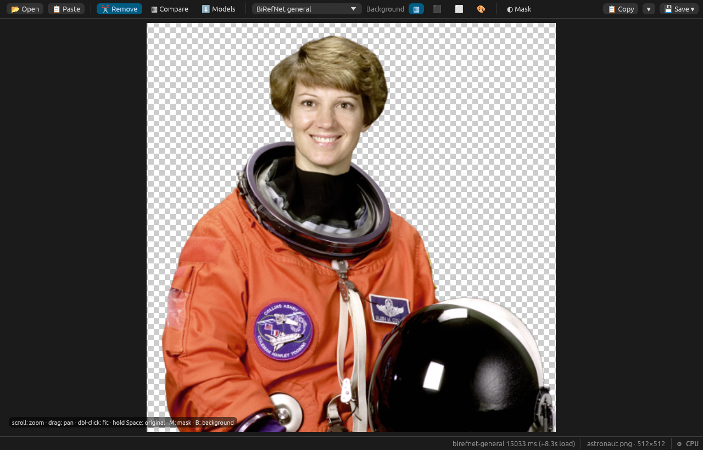
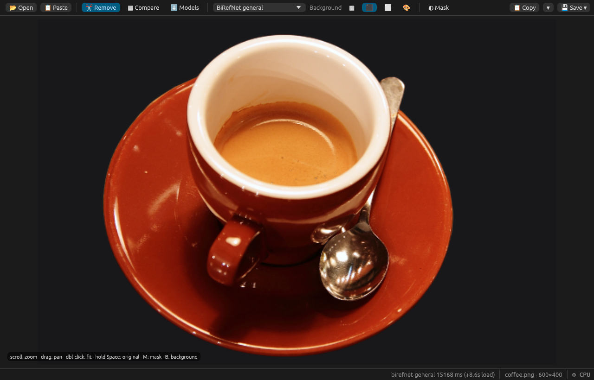
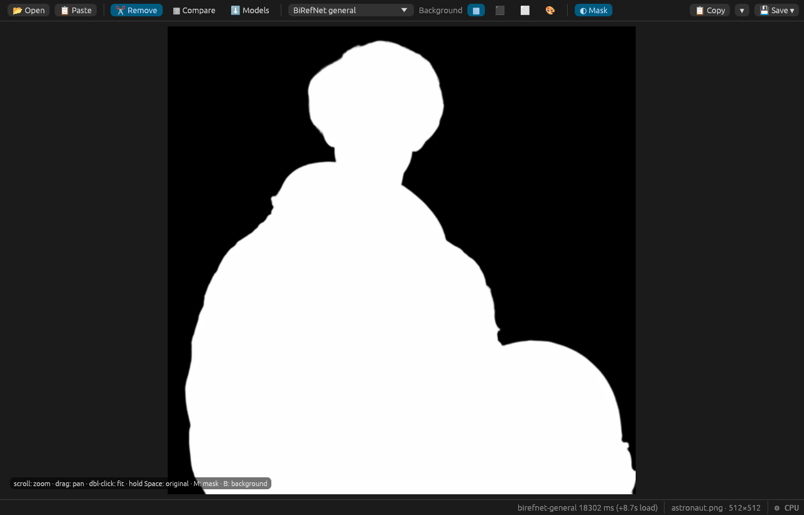
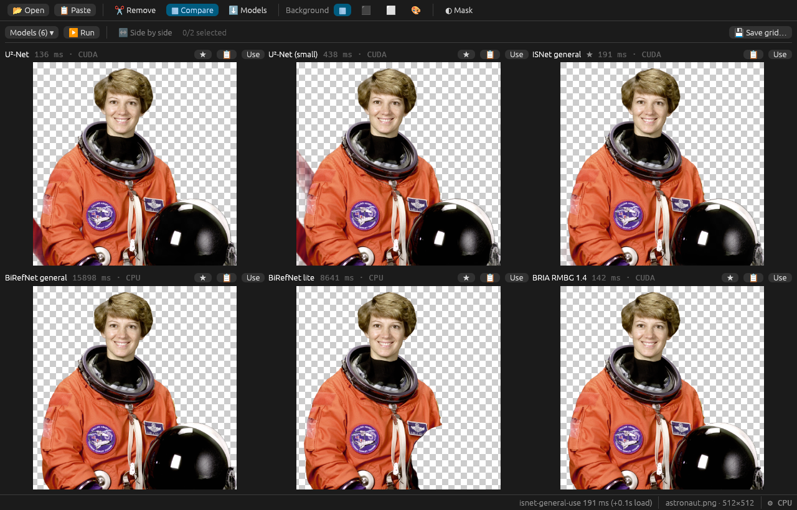
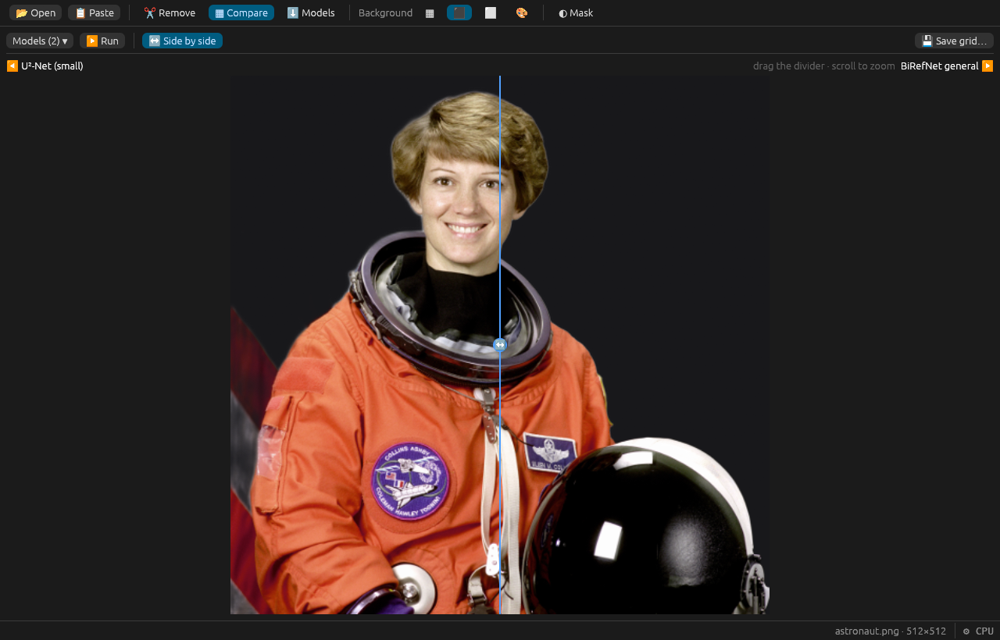
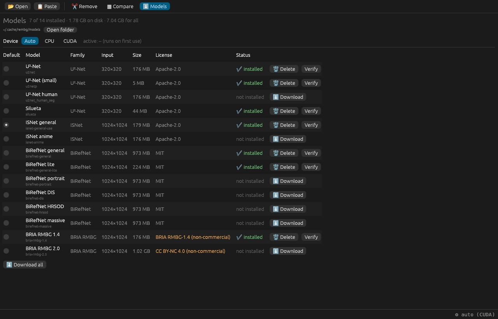

# rembg (native)

Local background removal in Rust: a headless engine, a CLI and a native GUI, for Linux and Windows.
Drop an image, get a cut-out, and compare 14 models side by side. Runs on CPU or GPU (CUDA on Linux, DirectML on
Windows), fully offline once models are downloaded.



## Features

- **Remove**: drop a file, paste (Ctrl+V) or open (Ctrl+O). Background removal runs on a worker thread, so the UI never blocks.
- **Preview backgrounds**: checkerboard, dark, light or any custom colour; zoom about the cursor, pan, hold Space for the original.
- **Output**: copy the result straight to the clipboard (no file needed), or save it as a transparent PNG/WebP, flattened
  onto the preview colour, or as the bare mask.
- **Compare**: run one image through many models: a grid with per-model inference time and device, synced zoom/pan,
  a mask toggle, an A/B slider for any two models, "use"/"set default" per tile, and export of the whole grid.
- **Model manager**: 14 models with size, input resolution, licence, download progress, delete, sha256 verify, default.
- **GPU**: CUDA 13 on Linux, DirectML on Windows (any DirectX 12 GPU), with automatic CPU fallback, also per model,
  e.g. when a model doesn't fit in VRAM.

## Screenshots

| | |
|---|---|
|  |  |
| **Preview background**: dark (also checker, light, custom colour) | **Mask view** (M): the raw alpha mask |

### Compare models

Every selected model runs on the same image. Zoom and pan are shared by all tiles, so the same detail is visible
everywhere; each tile shows inference time and device.



Click two tiles, then **Side by side**: drag the divider to compare edges. Here U²-Net (small) on the left leaves part
of the flag behind, while BiRefNet on the right removes it cleanly.



### Model manager



> Screenshots were taken on a laptop RTX 3060 (6 GB): small models ran on CUDA, BiRefNet didn't fit in VRAM and
> fell back to CPU automatically. Images are public domain / CC0 test photos from
> [scikit-image](https://github.com/scikit-image/scikit-image/tree/v0.19.3/skimage/data): astronaut (NASA),
> Chelsea the cat (Stefan van der Walt), coffee (Rachel Michetti).

## Install

Download a release from [Releases](https://github.com/gohorsebr/rembg/releases). Each archive contains `rembg`
(CLI, and `rembg gui`) and `rembg-gui` (opens the GUI directly).

| file | platform | GPU |
|---|---|---|
| `rembg-<ver>-x86_64-windows.zip` | Windows 10/11 x64 | DirectML (NVIDIA, AMD, Intel), else CPU |
| `rembg-<ver>-x86_64-linux.tar.gz` | Linux x86_64, glibc ≥ 2.39 (Ubuntu 24.04+) | CPU |
| `rembg-<ver>-x86_64-linux-cuda.tar.gz` | same | CUDA 13: run `./fetch-cuda-libs.sh` once (~2 GB), see `CUDA.txt` |

**Windows**: unzip anywhere and double-click `rembg-gui.exe` (no console window), or run `rembg.exe` from a terminal.
Models are stored in `%LOCALAPPDATA%\rembg\models`.

**Linux**:

```sh
tar xzf rembg-*-x86_64-linux.tar.gz && cd rembg-*/ && ./rembg-gui
```

## Models

| id | family | input | size | licence |
|---|---|---:|---:|---|
| `u2net` | U²-Net | 320 | 176 MB | Apache-2.0 |
| `u2netp` | U²-Net (small) | 320 | 5 MB | Apache-2.0 |
| `u2net_human_seg` | U²-Net (humans) | 320 | 176 MB | Apache-2.0 |
| `silueta` | U²-Net (pruned) | 320 | 44 MB | Apache-2.0 |
| `isnet-general-use` *(default)* | ISNet | 1024 | 179 MB | Apache-2.0 |
| `isnet-anime` | ISNet | 1024 | 176 MB | Apache-2.0 |
| `birefnet-general` | BiRefNet | 1024 | 973 MB | MIT |
| `birefnet-general-lite` | BiRefNet | 1024 | 224 MB | MIT |
| `birefnet-portrait` / `-dis` / `-hrsod` / `-massive` | BiRefNet | 1024 | 973 MB each | MIT |
| `bria-rmbg-1.4` | BRIA | 1024 | 176 MB | non-commercial |
| `bria-rmbg-2.0` | BRIA | 1024 | 1.02 GB | CC BY-NC 4.0 (non-commercial) |

Models download on first use into `~/.cache/rembg/models` (Windows: `%LOCALAPPDATA%\rembg\models`; override with `REMBG_HOME`) and are verified against
pinned sha256 hashes. Pre/post-processing matches the reference Python
[rembg](https://github.com/danielgatis/rembg) sessions.

## GUI

```sh
rembg gui [image] [--tab remove|compare|models] [-m MODEL] [--bg dark|light|checker|#rrggbb] [--mask]
          [--models a,b,c] [--split a,b]
```

| keys | |
|---|---|
| drop / Ctrl+V / Ctrl+O | load an image (paste accepts image data or a copied file path) |
| Ctrl+C / Ctrl+S | copy / save the transparent result |
| scroll · drag · double-click | zoom about cursor · pan · fit |
| hold Space | show the original |
| M / B | toggle mask view / cycle background (checker → dark → light → custom) |
| Ctrl+1/2/3 | Remove / Compare / Models tabs |

## CLI

```sh
rembg remove photo.jpg                      # -> photo_nobg.png
rembg remove photo.jpg --copy               # result to clipboard only (no file)
rembg remove shots/ -o out/ -m birefnet-general
rembg remove photo.jpg --mask -o mask.png
rembg remove photo.jpg --bg '#ffffff' -o flat.jpg
cat in.jpg | rembg remove - -o - > out.png
rembg compare photo.jpg -o grid.png [-m u2net,isnet-general-use] [--mask]
rembg models list | pull <id>… | pull --all | rm <id> | verify | default <id>
rembg info                                  # build / device probe
rembg --device auto|cpu|cuda|directml …
```

## Build

```sh
make release          # CPU build -> target/release/rembg (ONNX Runtime linked statically, single file)
make cuda             # CUDA build + bundles the CUDA 13 runtime (cudart/cuBLAS/cuDNN/cuFFT, ~2 GB) in target/release/lib
make check            # fmt + clippy + tests
make bench IMG=x.jpg  # time every installed model
make screenshots      # regenerate docs/screenshots (needs a display and the models used)
```

| crate | |
|---|---|
| `crates/core` (`rembg-core`) | headless engine: model registry, download/cache, pre/post-processing, ONNX Runtime inference, compositing, comparison grid. No UI deps. |
| `crates/gui` (`rembg-gui`) | egui/eframe app. |
| `crates/cli` (`rembg` binary) | `remove`, `compare`, `models`, `info`, `gui`. |

### Releases

`.github/workflows/release.yml` builds and publishes a release only when the version changes: bump
`version` under `[workspace.package]` in `Cargo.toml` and push to `main`. It runs the tests, builds Linux (CPU, CUDA) and
Windows (DirectML) variants, and creates the `v<version>` tag and release with all three archives and their sha256 files. Pushes that edit
`Cargo.toml` without changing the version, or whose `v<version>` tag already exists, do nothing. A manual run
(*Actions → Release → Run workflow*) builds artifacts only, unless *publish* is checked.

### GPU (CUDA)

- Built against ONNX Runtime 1.31 / CUDA 13: needs an NVIDIA driver ≥ 580 and an Ampere-or-newer GPU.
- The binary re-execs itself with `<exe dir>/lib` on `LD_LIBRARY_PATH`, so ship `rembg`,
  `libonnxruntime_providers_{cuda,shared}.so` and `lib/` together.
- Windows builds use DirectML instead (no extra downloads; DirectX 12 GPU). Linux CUDA builds don't exist for Windows yet.
- `--device auto` (default) uses the build's GPU backend when available, else CPU. If a model fails on the GPU at run time
  (e.g. out of VRAM) it is retried after freeing other sessions, then on CPU. BiRefNet / BRIA 2.0 at 1024² need
  roughly 8 GB+ of VRAM.

| model (600×399 photo) | 24-thread CPU | RTX 5070 Ti |
|---|---:|---:|
| isnet-general-use | 216 ms | 74 ms |
| birefnet-general-lite | 2920 ms | 139 ms |
| birefnet-general | 4653 ms | 287 ms |
| bria-rmbg-2.0 | 4536 ms | 267 ms |
